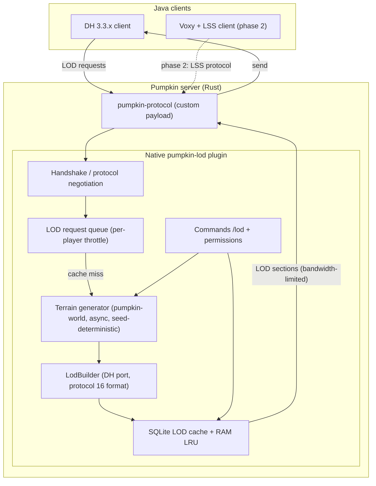

# pumpkin-lod — Specification (Cahier des charges)

**Project**: Server → client LOD (Level Of Detail) streaming plugin for the **Pumpkin** Minecraft server (Rust).
**Phase 1 target**: **Distant Horizons 3.3.x** clients (network protocol no. 16).
**Phase 2 target (optional)**: **Voxy + LOD Server Support (LSS)** clients.
**License**: **GPL-3.0-or-later** (mandatory: the LodBuilder and throttling are ported from DH Support, GPLv3+).
**Status**: Validated founding document. Phase 2 requires an LSS license check before any port.

---

## 1. Context and problem

- Pumpkin is a Minecraft server written in Rust: native plugins (`.so`/`.dll`) or WASM (Wasmtime/WIT), no Bukkit compatibility. PatchBukkit (embedded JVM) is too immature for plugins relying on internals.
- **Distant Horizons (DH)** works client-side only (local cache); without server support, every player must explore the terrain themselves to fill their LODs.
- The official **DH Support** plugin (GitLab, GPLv3+) does this streaming on Bukkit/Spigot/Paper/Folia only.
- **Voxy** is client-only (Fabric + Sodium); server streaming exists only via **LSS** (Fabric/Paper/Folia/NeoForge/Sponge), never ported to Pumpkin.
- Community precedent: `filiphsps/pumpkin-plugins` publishes `distant-horizons-support-pumpkin 0.1.1` (TypeScript/WASM), but it is **limited to already-loaded chunks and cache** — on-demand distant terrain generation is blocked by the WASM sandbox (issue #159, PR #173 "Pumpkin++" in progress).

**Problem**: no Pumpkin server can currently stream server-generated LODs to DH or Voxy clients.

## 2. Objectives

1. Give players on a Pumpkin server an extended view (hundreds of chunks) without prior exploration, via DH first.
2. Generate LODs server-side asynchronously, never blocking the tick.
3. Converge with the ecosystem: reuse existing client protocols (DH protocol 16, then LSS) rather than inventing a protocol.

## 3. Scope

### Included (phase 1 — DH)

- **Native Rust plugin** for Pumpkin (native loader), no WASM.
- Handshake and LOD support announcement to DH clients at connection.
- Reception of client LOD requests (custom payload) and response with LOD sections.
- On-demand distant chunk generation via direct access to `pumpkin-world`.
- LOD construction in the DH format (port of DH Support's LodBuilder).
- Persistent LOD cache (SQLite) per world/dimension.
- Independent throttling of login-sync / regular requests, per-player bandwidth limit (KB/s).
- Admin commands: `/lod pregen`, `/lod status`, `/lod reload`, `/lod resend <player>`, `/lod purge-cache`.
- TOML configuration file (`plugins/lod/config.toml`).

### Included (phase 2 — Voxy/LSS, conditional)

- Server-side port of the LSS protocol to Pumpkin (the LSS client mod remains unchanged and compatible).
- Minimal scope: terrain download service to Voxy clients. Far players, map ingestion (Xaero's/JourneyMap): out of initial scope.

### Excluded

- Any client modification (DH, Voxy, LSS mods used as-is).
- Bedrock support (LOD clients are Java-only).
- LOD rendering of complex beacon/lights structures before v1 (`include_beacons` option in backlog).

## 4. State of the art (references)

| Project | Role | Reusability |
|---|---|---|
| DH Support (GitLab, GPLv3+) | Reference implementation of the DH server protocol, LodBuilder, throttling | Source of the GPL port; protocol 16 documented by the code |
| `dandeman26/dhsupport-protocol16` | Unofficial Paper "protocol 16" build | Proof the protocol is reimplementable; helps decoding |
| `filiphsps/pumpkin-plugins` | Pumpkin DH support TS/WASM 0.1.1 | Pumpkin integration reference; LodBuilder already ported to TS; **reference only, not code reuse** — their stack cannot cover native generation |
| VoX/lod-server-support (LSS) | LOD streaming for Voxy clients | Source of the phase 2 port; **license to be verified before any port** |
| `voxy-worldgen` (Modrinth) | Community Fabric alternative | Not applicable (no Pumpkin server build) |

## 5. Functional requirements

| ID | Requirement | Priority |
|---|---|---|
| EF-1 | The plugin announces LOD support to DH clients at connection; a client without DH is unaffected | Must |
| EF-2 | The server answers a client's LOD requests by sending sections in the DH 3.3.x format (protocol 16) | Must |
| EF-3 | On cache miss, distant terrain is generated server-side without loading player chunks. **Generated distant chunks are NOT persisted as full chunks**: only LODs are cached; distant terrain is regenerated deterministically from the world seed on cache miss | Must |
| EF-4 | LODs are persisted per world/dimension and reused across restarts | Must |
| EF-5 | Login-sync and regular requests are throttled independently; max per-player bandwidth configurable | Must |
| EF-6 | `/lod pregen <radius>` pre-fills the cache around the spawn point in a bounded, interruptible way, from the world seed (deterministic) | Must |
| EF-7 | Modifications of *loaded* chunks (worldedit, growth, explosions) invalidate affected LODs per a configurable policy (immediate / periodic / disabled). Distant generated chunks are out of scope (they are never persisted as terrain) | Should |
| EF-8 | `/lod status` reports: cache (size, hit-rate), generation queues, consumed bandwidth, connected clients' protocol versions | Should |
| EF-9 | Multi-world and dimensions (Nether/End) handled with separate caches | Must |
| EF-10 | Fine-grained permissions: `lod.admin`, `lod.pregen`, admin-only throttle bypass | Should |
| EF-11 | LSS port: a Voxy + LSS client connected receives the server's LODs without exploring | Phase 2 |
| EF-12 | Protocol version negotiation: clean refusal and log if the DH client uses an unsupported protocol | Must |

## 6. Non-functional requirements

| ID | Requirement |
|---|---|
| ENF-1 | **Native Rust plugin** (native loader `.so`/`.dll`/`.dylib`): direct access to `pumpkin-world`; zero FFI overhead. Justification: the WASM sandbox cannot generate chunks outside the loaded area |
| ENF-2 | All generation/LOD construction runs off-tick (Tokio tasks), configurable CPU budget (thread count, like DH Support's `scheduler_threads`) |
| ENF-3 | Bounded memory: RAM cache capped (LRU), transparent disk spillover |
| ENF-4 | Pinned Pumpkin version: Pumpkin has no 1.0, the plugin API is unstable; compatibility checked per release. The pin must reference a tagged release; if the needed API is only available on a commit, document the exception explicitly in the README and CI manifest |
| ENF-5 | Code derived from DH Support remains **GPLv3+**; the whole project is published **GPL-3.0-or-later**. This is a validated prerequisite, not an open decision. The LSS license must be checked before any phase 2 work |
| ENF-6 | Total network bandwidth capped (value 0 = unlimited, same behavior as DH Support) |
| ENF-7 | Tests: unit (LOD serialization, throttling), integration (Pumpkin server + real DH client, visual and log verification). Since no headless DH client exists, CI replays recorded DH client traffic captures; the real-client check is manual acceptance only |
| ENF-8 | No blocking dependency on unpublished CI builds; tagged versions only |

## 7. Target architecture

**Structural decisions**:
- Native over WASM: EF-3 is impossible in the sandbox (established by the existing pumpkin-plugins project).
- One binary crate + a `lod-core` crate (protocol, LodBuilder, cache) testable independently.
- The LOD format follows DH Support (binary compatible), no homegrown format.
- Distant generation is **seed-deterministic and LOD-cache-only**: no full distant chunks are persisted, which removes the invalidation problem for distant terrain and keeps disk usage proportional to the LOD cache, not the world.

## 8. Milestones

| Milestone | Content | Exit criterion |
|---|---|---|
| **M0 — Spike (throwaway)** | Handshake + hardcoded LOD section sent to a real DH client connected to Pumpkin. **Spike code is explicitly disposable** | The client renders the section in its DH view |
| **M1 — MVP** | EF-1, EF-2, EF-4, EF-12: request reception, minimal LodBuilder, cache, throttled sending | A player sees distant terrain they never explored |
| **M2 — On-demand generation** | EF-3, EF-5, EF-9, ENF-2/3: async pumpkin-world, CPU/RAM budgets | `/lod pregen 512` around spawn with no measurable TPS degradation |
| **M3 — Operations** | EF-6, EF-7, EF-8, EF-10: full commands, invalidation, monitoring | Usable in production on a real server |
| **M4 (optional) — LSS** | EF-11: LSS server port for Voxy clients (license check first) | A Voxy+LSS client receives the LODs |

## 9. Acceptance criteria

1. **Throttled delivery target**: at login, a DH 3.3.x client (unmodified, vanilla + DH only) receives distant LODs at the configured per-player bandwidth limit; the throttled stream reaches the configured render distance within 2 minutes on a properly throttled link. Full coverage of 512×512 chunks is not expected within 2 minutes — the criterion is a sustained throttled stream plus visible distant terrain, not complete coverage.
2. Client without the mod: strictly unchanged experience.
3. Server TPS: variation < 5 % in steady state with 5 players and pregen running (measured via `/lod status`).
4. Server restart: cache reused, no regeneration of already-built areas.
5. A DH client using an unsupported protocol is cleanly refused (log, no server crash).
6. Green CI test suite on the pinned Pumpkin version.

## 10. Risks

| Risk | Severity | Mitigation |
|---|---|---|
| Unstable Pumpkin plugin API (no 1.0) | High | Strict version pin; CI against the pinned release; tracking upstream breaking changes |
| DH protocol evolves (the protocol number already changed) | High | Negotiation + EF-12; protocol layer isolated in `lod-core` |
| Terrain generation diverges from vanilla (false LOD rendering) | Medium | Visual integration tests; comparison with DH Support output on the same world |
| GPLv3 compliance misjudged | Medium | **Resolved**: GPLv3 accepted upfront at project creation; LSS license check remains a phase 2 gate |
| Overlap with `filiphsps/pumpkin-plugins` (DH TS/WASM progress) | Medium | Native generation is out of reach for their stack; this project reuses their TS LodBuilder as a *reference* only; if their WASM+native bridge lands, re-evaluate complementarity |
| CPU load of on-demand generation | Medium | Thread budgets, N-sized generation (lower detail levels first), pregen recommended |
| Phase 2: LSS license unverified | Medium | Verification before any port; protocol reimplemented from scratch if necessary |

## 11. Development workflow

- One branch per feature (`feat/`, `fix/`, `spike/`), a PR every time, **never self-approved by the author**.
- Conventional Commits, CI (build + tests + clippy) required green before merge.
- Tagged releases `vX.Y.Z` aligned with the supported Pumpkin version.
- All commits, PRs, and project content in English; commit author: damienmillet.

## 12. Decisions

| # | Decision | Status |
|---|---|---|
| 1 | Own repo vs contribution to `filiphsps/pumpkin-plugins` | **Decided: own repo** — native generation is out of reach for their TS/WASM stack; their TS LodBuilder is used as a reference only |
| 2 | Target Pumpkin version | Pin the latest stable release at project start (recorded in CI manifest and README) |
| 3 | Target MC/DH protocol version | 26.x + DH 3.3.x (protocol 16) — to confirm against players' real clients |
| 4 | Phase 2 (Voxy/LSS) | Backlog: included in the roadmap as M4, gated on the LSS license check |
| 5 | License | **Decided: GPL-3.0-or-later** (mandatory given the DH Support port) |
| 6 | Distant generation model | **Decided: LOD-cache-only** — distant terrain regenerated deterministically from the seed; no full distant chunks persisted |

## References

- DH Support: https://gitlab.com/distant-horizons-team/distant-horizons-server-plugin
- Voxy: https://github.com/MCRcortex/voxy/tree/dev
- LSS: https://github.com/VoX/lod-server-support
